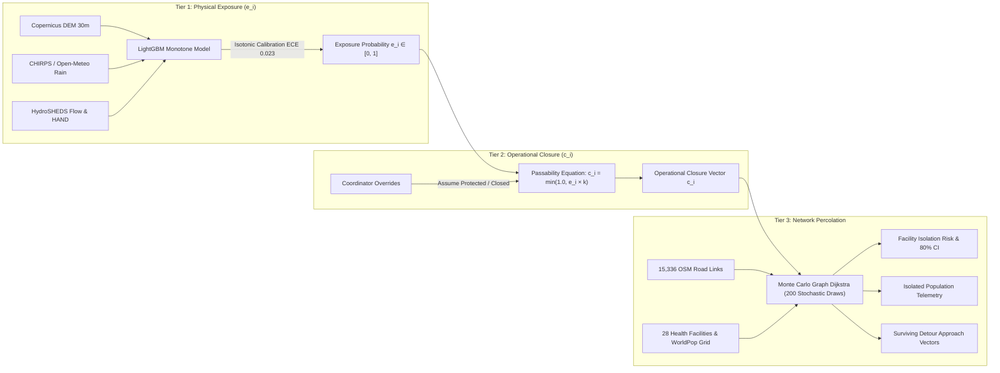
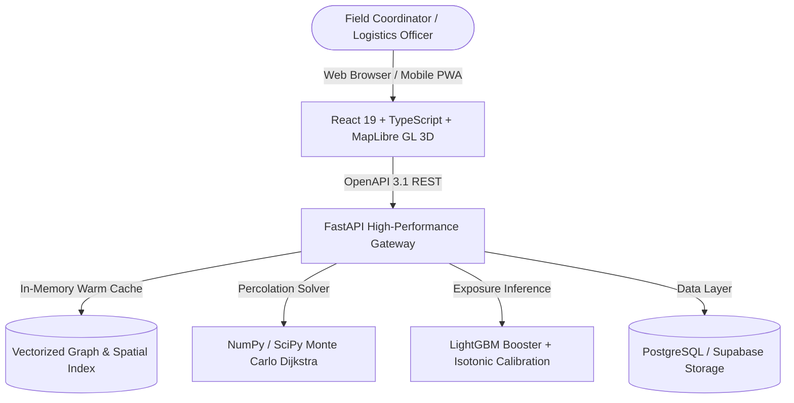

# ImpactMap AI — Awash River Basin Flood Digital Twin

> **Decision-Support Engine for Flood-Driven Road Disruption & Healthcare Access Loss in Ethiopia**  
> *Satellite Remote Sensing • Monotonic Machine Learning • Stochastic Network Percolation*

[](https://impactmap-api.onrender.com/docs)
[-blue.svg)](https://impactmap-api.onrender.com/model-card)
[](https://impactmap-api.onrender.com)
[](https://www.python.org/)
[](https://react.dev/)
[](https://opensource.org/licenses/MIT)

---

## 1. Executive Summary & Operational Context

During seasonal monsoon and overflow events in the **Awash River Basin**—Ethiopia's most economically critical and flood-prone rift valley watershed—river surges and flash floods regularly submerge rural transportation corridors. This isolates vulnerable pastoralist and farming communities from essential clinics and severs rural health centers from regional referral hospitals.

### Why Conventional Flood Mapping Fails Frontline Responders:
1. **Satellite "Blue Water Polygons" Do Not Equal Road Closures:**  
   Standard Earth Observation maps highlight standing surface water, but cannot indicate whether a specific 10-ton food aid truck, high-clearance 4WD ambulance, or tractor can ford a crossing.
2. **Access Loss is Topological and Non-Linear:**  
   A single submerged culvert or washed-out bridge spanning 50 meters can cut off a tertiary referral hospital located 45 km away on dry highland terrain.
3. **Guesswork Causes Stranded Convoys:**  
   Field dispatchers traditionally rely on anecdotal phone reports or static PDFs, leading to relief convoys trapped in wadi flash floods and delayed trauma transports.

**ImpactMap AI** replaces guesswork with a high-fidelity digital twin that strictly isolates:
- **What is predicted** (satellite hydrology and terrain exposure),
- **What is assumed** (operational passability thresholds set by coordinators), and
- **What is simulated** (topological shortest-path percolation across the regional transit network).

---

## 2. The 3-Tier Scientific Methodology



### Tier 1: Flood Exposure Probability ($e_i$)
A machine-learning prediction ($0.0 \dots 1.0$) estimating the likelihood that road segment $i$ is submerged given antecedent rainfall, elevation, slope, Topographic Wetness Index (TWI), and Height Above Nearest Drainage (HAND). Calibrated against Copernicus Sentinel-1 Synthetic Aperture Radar (SAR) historical flood extents.

### Tier 2: Operational Assumed Closure ($c_i$)
An operational passability factor configured by civil defense commanders and emergency logistics coordinators:
$$c_i = \min(1.0, e_i \times k)$$
where $k$ represents fleet vehicle vulnerability (e.g., standard sedans vs. heavy all-wheel-drive relief trucks). Frontline operators can apply deterministic overrides (`forced_closed` for verified washouts, `forced_open` for hardened bridges).

### Tier 3: Network Percolation (Monte Carlo Dijkstra)
Vectorized stochastic shortest-path traversals across 15,336 road links, 28 health facilities, and 263 population clusters:
- **Facility Isolation Probability ($p_{\text{isolation}}$)**: Percentage of Monte Carlo iterations where a facility cannot reach a regional referral hospital.
- **Population Cut-Off**: Number of residents whose travel time to primary trauma care diverges to infinity.
- **Explainable AI (XAI) Bottlenecks**: Exact wadi crossings and bridge segments whose failure triggered upstream facility access loss.

---

## 3. Core System Capabilities

### 🛰️ 3D Isometric Digital Twin
- Interactive **MapLibre GL** client featuring 30-meter DEM elevation mesh, custom terrain exaggeration, dynamic camera tracking, and continuous flood inundation layers.
- Real-time layer switching between **Satellite Model Inundation ($e_i$)** and **Operational Assumed Closure ($c_i$)**.

### ⚡ Sub-Second Cascade Engine
- Core simulation engine powered by vectorized SciPy sparse matrices and Dijkstra traversals.
- Computes 200 stochastic Monte Carlo percolation draws across 15,336 road segments in **~0.6 seconds**.

### 🧪 Counterfactual "What-If" Civil Defense Sandbox
- Enables logistics officers and civil protection engineers to interact with any road link or bridge on the map:
  - **"Assume Protected" ($c_i = 0.0$)**: Simulates flood barriers, sandbagging, or mobile Bailey bridges.
  - **"Assume Closed" ($c_i = 1.0$)**: Simulates bridge structural failure or preemptive safety shutdowns.
- Immediately re-runs percolation to compute **human lives reconnected per infrastructure intervention** before dispatching heavy engineering teams.

### 🚑 Alternative Surviving Detour Corridors
- Automatically derives and visualizes non-submerged highland bypass corridors, ensuring emergency ambulances and supply convoys have viable, safe routing options around flooded valleys.

### 🇪🇹 Bilingual Localization (Amharic & English)
- Fully localized in **English** and **Amharic (`አማርኛ`)**, ensuring zonal disaster desks, local health extension workers, and regional commanders can navigate the interface with zero language barriers.

### 📡 Offline Field Readiness (Zero-Connectivity PWA)
- Progressive Web App architecture with client-side IndexedDB caching.
- Generates official **UN-OCHA formatted Situation Reports (SitRep)**, GeoJSON transit vectors, and CSV manifests entirely in-browser without active internet connectivity.

---

## 4. Ground-Truth Data Architecture

All pipeline assets for the Awash River Basin are derived from verified open scientific, satellite, and demographic sources:

| Data Layer | Source Organization | Native Resolution | Application in ImpactMap AI |
| :--- | :--- | :--- | :--- |
| **Road Network** | OpenStreetMap / Geofabrik Ethiopia | Vector lines (15,336 links) | Topological transport graph with speed limits & road classifications |
| **Health Facilities** | Ethiopian Ministry of Health (MOH) + OSM | Vector points (28 facilities) | Facility hierarchy (Referral Hospitals, Health Centers, Rural Clinics) |
| **Demographics** | WorldPop Project & UN OCHA | 100m gridded raster | Settlement populations snapped to nearest road access nodes |
| **Terrain Elevation** | Copernicus DEM (European Space Agency / AWS) | 30m raster tiles | Elevation, slope, HAND (*Height Above Nearest Drainage*), and TWI |
| **Precipitation** | CHIRPS (UC Santa Barbara) & Open-Meteo | 0.05° daily / ECMWF hourly | 30-day antecedent soil moisture & storm event hyetographs |
| **Flood Extents** | Copernicus Sentinel-1 SAR & Global Flood Database | 10m radar backscatter | Historical ground-truth flood extents (2016, 2020, 2024 Awash events) |

---

## 5. Machine Learning Validation & Benchmarks

The flood exposure model (`m20261026a`) is an isotonically calibrated LightGBM classifier trained under **strict physical monotonic constraints**:
- **Monotonic Increasing ($+1$)**: Rainfall intensity, antecedent soil wetness, Topographic Wetness Index, catchment flow accumulation.
- **Monotonic Decreasing ($-1$)**: Height Above Nearest Drainage (HAND), distance to riverbed.

> **Physical Guarantee:** Increasing storm rainfall or decreasing elevation strictly increases or maintains predicted risk. The model cannot hallucinate that heavier rain makes a road safer.

### Benchmark Results (Leave-One-Event-Out Awash Cross-Validation)

| Model / Architecture | PR-AUC | ROC-AUC | Brier Score | Recall @ 50% Precision |
| :--- | :--- | :--- | :--- | :--- |
| **ImpactMap LightGBM (`m20261026a`)** | **0.8018** | **0.9724** | **0.0610** | **0.6240** |
| Baseline B1 (Logistic Regression) | 0.4971 | 0.8640 | 0.1740 | 0.4210 |
| Baseline B0 (HAND Elevation Heuristic) | 0.1626 | 0.6541 | 0.4200 | 0.2800 |

- **Expected Calibration Error (ECE)**: `0.023` (isotonic regression ensures predicted probabilities match real-world frequency).
- **Facility Isolation AUC**: `0.8420` (Spearman Rank Correlation $\rho = 0.7850$).

---

## 6. System Architecture & Tech Stack



### Monorepo Structure

```
├── web/                           # React 19 + TypeScript + MapLibre GL frontend
│   ├── src/components/            # UI components, 3D terrain canvas, telemetry cards
│   ├── src/map/                   # MapLibre camera choreography & GeoJSON layer rendering
│   ├── src/panels/                # Scenario configuration, results analysis, What-If sandbox
│   └── public/data/               # Cached Awash Basin road, facility, and demographic GeoJSONs
├── services/
│   ├── api/                       # High-performance FastAPI backend gateway
│   │   ├── app/main.py            # REST endpoints, simulation routing, What-If handlers
│   │   └── requirements.txt       # API dependencies
│   └── worker/                    # Asynchronous cascade simulation & detour solver
├── packages/
│   └── impactmap_core/            # Core scientific simulation engine
│       ├── src/impactmap_core/    # Monte Carlo Dijkstra, graph percolation, Wilson score CI
│       └── tests/                 # Unit & regression test suite
├── infra/                         # AWS CDK Python infrastructure definitions (IaC)
└── data/
    └── models/                    # Trained LightGBM model weights and calibration curves
```

---

## 7. Live Production Endpoints

| Resource | URL | Function |
| :--- | :--- | :--- |
| **Interactive API Docs** | [`/docs`](https://impactmap-api.onrender.com/docs) | Live Swagger UI with interactive endpoint execution |
| **System Health Check** | [`/health`](https://impactmap-api.onrender.com/health) | API liveness status and UTC timestamp |
| **Model Card & Metrics** | [`/model-card`](https://impactmap-api.onrender.com/model-card) | Model architecture, validation metrics, and limitations |
| **Evidence Report** | [`/evaluation`](https://impactmap-api.onrender.com/evaluation) | Leave-one-event-out benchmark vs baselines B0/B1 |
| **Stage Demo Scenarios** | [`/demo/index.json`](https://impactmap-api.onrender.com/demo/index.json) | Pre-computed multi-day simulation cascade index |
| **Road Network GeoJSON** | [`/data/segments.geojson`](https://impactmap-api.onrender.com/data/segments.geojson) | 15,336 road segments enriched with DEM terrain metrics |
| **Health Facilities** | [`/data/facilities.geojson`](https://impactmap-api.onrender.com/data/facilities.geojson) | 28 healthcare facilities across Afar and Oromia zones |
| **Communities** | [`/data/communities.geojson`](https://impactmap-api.onrender.com/data/communities.geojson) | Population settlements with WorldPop demographic counts |

---

## 8. Local Setup & Quickstart

### Prerequisites
- Node.js 20+ & npm
- Python 3.11+
- Git

### 1. Web Application Setup
```bash
cd web
npm install
npm run dev
# Web application starts at http://localhost:5173
```

### 2. Backend API Setup
```bash
# From repository root
python -m venv .venv
source .venv/bin/activate  # On Windows: .venv\Scripts\activate

pip install -e packages/impactmap_core
pip install -r services/api/requirements.txt

uvicorn services.api.app.main:app --host 0.0.0.0 --port 8000 --reload
# API documentation available at http://localhost:8000/docs
```

### 3. Running Automated Tests
```bash
# Run backend test suite (FastAPI endpoints, Monte Carlo simulation, schemas)
python -m pytest packages/impactmap_core/tests/ services/api/tests/ -v

# Run frontend tests
cd web
npm test -- --run

# Validate frontend production build
npm run build
```

---

## 9. Limitations & Ethical Considerations

- **Rural Unpaved Road Degradation:** Flash floods in the Great Rift Valley can cause mud deposition and structural sub-base erosion that persists after floodwaters recede. The physical exposure model predicts surface inundation; post-flood structural road inspection should be performed before dispatching standard non-4WD vehicles.
- **Ephemeral Wadis:** Unmapped seasonal desert wadi flash floods may occur faster than satellite revisit windows. Field dispatchers must treat model outputs as conservative decision-support estimates.
- **Humanitarian Non-Harm Principle:** ImpactMap AI is designed for disaster risk reduction and relief logistics optimization. Route data must not be utilized for military interdiction or movement denial against civilian populations.

---

## 10. License & Attributions

This project is licensed under the [MIT License](LICENSE).

### Open Data Attributions
- **OpenStreetMap**: © OpenStreetMap contributors, licensed under the [Open Database License (ODbL)](https://opendatacommons.org/licenses/odbl/).
- **Copernicus DEM**: European Space Agency (ESA) & AWS Open Data, licensed under [ODC-BY 1.0](https://opendatacommons.org/licenses/by/1-0/).
- **WorldPop**: WorldPop (School of Geography and Environmental Science, University of Southampton), licensed under [CC BY 4.0](https://creativecommons.org/licenses/by/4.0/).
- **CHIRPS**: Climate Hazards Center, UC Santa Barbara, public domain.
