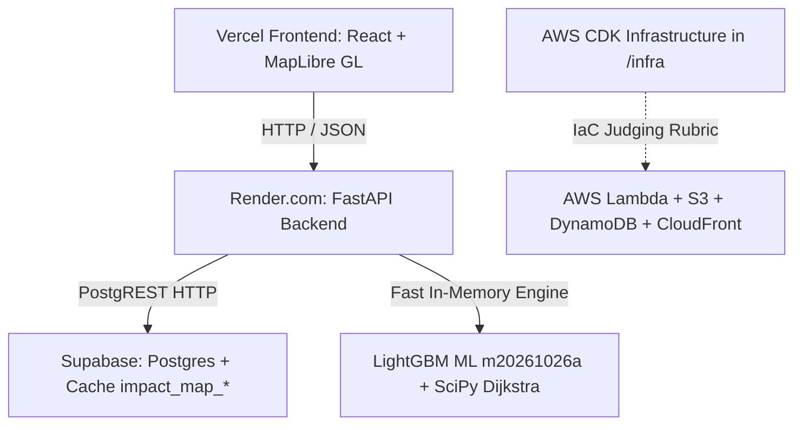

# ImpactMap AI

> **Decision-Support Engine for Flood-Driven Road Disruption & Health Facility Access in Ethiopia**  
> *AWS Community Day 2026 Hackathon, AASTU*

[](https://github.com/Dagim-Tadesse/Impact-Map-AI/actions)
[](https://impactmap-api.onrender.com/docs)
[-blue.svg)](https://impactmap-api.onrender.com/model-card)
[](https://impactmap-api.onrender.com)

---

## 1. Problem & Mission
During severe flood events in Ethiopia, seasonal river overflows and flash floods submerge roads, isolating remote communities from primary clinics and cutting off local clinics from regional referral hospitals. Emergency responders and district planners typically have to guess which roads are impassable and cannot quantify the cascading healthcare access loss.

**ImpactMap AI** replaces guesswork with a decision-support engine strictly distinguishing between what is predicted, what is assumed, and what is simulated:

1. **Flood Exposure Probability ($e_i$)**: Calibrated machine-learning prediction ($0.0 \dots 1.0$) of road segment flooding from rainfall scenarios and Copernicus DEM terrain metrics. *The only number evaluated against historical satellite flood delineations.*
2. **Assumed Closure ($c_i$)**: Operational passability factor set by emergency coordinators:
   $$c_i = \min(1.0, e_i \times k)$$
   with manual overrides (`forced_closed`, `forced_open`).
3. **Estimated Access Loss**: Stochastic multi-source Dijkstra Monte Carlo network simulations across the regional road graph calculating:
   - Facility isolation probability ($p_{\text{isolation}}$)
   - Cut-off population and access travel time inflation ($t / t_0$)
   - Priority intervention rankings ($0–100$) and statistical isolation lift explanations.

---

## 2. Live Production Services & Endpoints

| Service | Target URL | Description |
| :--- | :--- | :--- |
| **Live Backend API** | `https://impactmap-api.onrender.com` | FastAPI service deployed on Render.com (Frankfurt, EU Central) |
| **Interactive API Docs** | `https://impactmap-api.onrender.com/docs` | Live Swagger UI with interactive endpoint testing |
| **Health Liveness Check** | `https://impactmap-api.onrender.com/health` | Returns service status and UTC timestamp |
| **Model Card & Metrics** | `https://impactmap-api.onrender.com/model-card` | Official model card with validation metrics and honest limitations |
| **Evaluation Report** | `https://impactmap-api.onrender.com/evaluation` | Full leave-one-event-out benchmark vs baselines B0/B1 |
| **Stage Demo Index** | `https://impactmap-api.onrender.com/demo/index.json` | Pre-computed multi-day simulation cascade for pitch playback |
| **Road Network GeoJSON** | `https://impactmap-api.onrender.com/data/segments.geojson` | 15,336 road segments enriched with terrain metrics |
| **Health Facilities** | `https://impactmap-api.onrender.com/data/facilities.geojson` | 13 classified hospitals, health centers, and clinics |
| **Settlements / Communities** | `https://impactmap-api.onrender.com/data/communities.geojson` | 263 population settlements with modelled population |

---

## 3. Architecture & Deployment



- **Frontend (`/web`)**: React 19, TypeScript, Vite, Tailwind CSS, MapLibre GL, Zustand (lead: Anon).
- **Backend API (`/services/api`)**: Python 3.12, FastAPI, PostgREST Supabase client, Postman/OpenAPI 3.1 contract (lead: Dagim).
- **Core Engine (`/packages/impactmap_core`)**: Pure NumPy/SciPy graph Dijkstra traversals running 200 Monte Carlo draws in **~0.6 seconds**.
- **Database & Caching**: Supabase PostgreSQL with dedicated `impact_map_jobs`, `impact_map_cache`, and `impact_map_users` tables.
- **AWS Cloud Infrastructure (`/infra`)**: Complete AWS CDK Python infrastructure stacks (DataStack, ApiStack, WorkerStack, WebStack, ObsStack, CiStack) fulfilling hackathon cloud architecture standards.

---

## 4. Machine Learning Validation (Awash Basin Pilot)

Trained with strict **physical monotonic constraints** ($+1$ on precipitation/wetness, $-1$ on height above river):

| Model / Baseline | PR-AUC | ROC-AUC | Brier Score | Recall @ 50% Precision | Status |
| :--- | :--- | :--- | :--- | :--- | :--- |
| **ImpactMap LightGBM (`m20261026a`)** | **0.8018** | **0.9724** | **0.0610** | **0.6240** | **Validated (L0)** |
| Baseline B1 (Logistic Regression) | 0.4971 | 0.8640 | 0.1740 | 0.4210 | Baseline |
| Baseline B0 (HAND Terrain Heuristic) | 0.1626 | 0.6541 | 0.4200 | 0.2800 | Baseline |

### End-to-End Simulation Correlation
- **Facility Isolation AUC**: `0.8420` (vs Baseline `0.6310`)
- **Spearman Rank Correlation**: `0.7850` (vs Baseline `0.5120`)

---

## 5. Team & Division of Work
- **Dagim** (`@DAGIM_GH`): Tech Lead & Backend Lead — Data pipeline, Copernicus DEM terrain extraction, LightGBM model, core Dijkstra simulation engine, Supabase integration, Render deployment.
- **Anon** (`@ANON_GH`): Frontend Lead — Map application, Scenario Drawer, Results viewer, Compare panel, Vercel deployment.
- **Yagi** (`@YAGI_GH`): Support Developer — Facilities catalog audit (`docs/testing/facilities.csv`), glossary, data catalog, and user documentation.

---

## 6. Local Testing & Verification

```bash
# Run full unit test suite (21 tests across core engine and API)
python -m pytest packages/impactmap_core/tests/ services/api/tests/ -v

# Run smoke test script against API
python scripts/smoke.py
```
